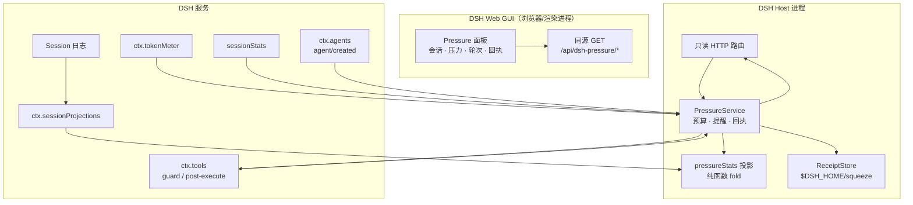

# DSH Pressure（压力表）· 技术方案

> 与[《DSH Pressure 需求单》](./requirements.zh-CN.md)配套的实现设计。本文描述 v0.1 的架构、DSH 集成点、投影与预算算法、存储/API/UI、测试与发布。**本轮只交付设计，不安装、不修改 profile。**
>
> 非 DeepSeek 官方项目。DeepSeek Harness、DSH 及相关商标归其所有者。

| 项 | 内容 |
|---|---|
| 文档版本 | v0.1（Draft） |
| 文档状态 | 设计已冻结（v0.1）；实现偏差与进度见 [compat-notes](./compat-notes.md) 与[实现状态](./implementation-status.md) |
| 更新日期 | 2026-11-13 |
| 目标运行时 | DSH `0.2.2-rc.3`（已验证）/ Node ≥ 22 / Windows、macOS、Linux |
| 目标包 | `dsh-pressure`（暂定；发布前做名称检索） |
| 形态 | Cordis Host 插件 + Web Client 插件（bundle） |
| 关联需求 | [requirements.zh-CN.md](./requirements.zh-CN.md) |

---

## 0. 结论先行

DSH Pressure 是一个**不调用模型、不注册模型工具、不保存正文**的循环治理插件：

- **Host 半**在 DSH 主进程内维护一个纯函数会话投影，读取官方 token/统计投影，执行预算守卫与轮末回执落盘。
- **Client 半**只通过同源只读 HTTP 读取聚合值，渲染压力面板；不直接读 Session，不接触正文。
- **干预**只发生在两个明确的点：`tools/guard()` 拒绝新的工具调用，`tools/post-execute` 向当前工具结果追加一条短提醒。二者都可关闭、可审计。
- **证明**靠每轮一张可导出回执与预注册基准，而不是一个不可解释的“效率分”。

### 0.1 关键设计裁决

| 编号 | 裁决 | 放弃的方案 | 理由 |
|---|---|---|---|
| TD-01 | token/缓存/上下文读数复用官方 `tokenUsage`、`sessionStats`、`tokenMeter` | 自己按字符数估算 | 官方已处理 retry、缓存、图片与上下文口径；自算会与 UI 不一致 |
| TD-02 | 自建 **host-only** 会话投影，只存计数/哈希/边界 | 订阅 `session/event` 自己扫全量日志 | 投影是 DSH 的增量机制；可 checkpoint、可重放、卸载即清理 |
| TD-03 | 不注册模型工具；提醒走 `tools/post-execute` 的 `additionalContexts` | 注册 `pressure_status` 工具 | 工具 schema 本身是固定 token 成本；提醒只在触发时付一次 |
| TD-04 | 强制模式用同步 `tools/guard` 拒绝工具调用 | 直接 `agent.cancel()` | 拒绝工具可控、可解释、可恢复；直接杀 turn 太粗暴 |
| TD-05 | 默认 `observe`，`coach`/`enforce` 显式开启 | 默认强制 | 监督器必须先被用户看见并信任（参考 `dsh-governor` 的观察优先） |
| TD-06 | 不提供单一效率分 | 加权总分 | 成本、上下文、可靠性不可通约；分数会掩盖误报 |
| TD-07 | 回执写插件自己的目录，不写 Session | 往会话日志追加插件事件 | 避免污染模型历史与 Session 格式；回执是派生数据 |
| TD-08 | 面板只读，变更走 `/squeeze` 命令 | 面板直接改 profile | 减少写面与 CSRF/误操作风险 |
| TD-09 | 纯 ESM、零打包依赖（仅宿主 peer helper）、手写 React `h` | TypeScript + 构建链 + UI 库 | 与本地已验证的 `dsh-cloud-memory`/`dsh-swarm` 一致；安装即用 |
| TD-10 | GitHub + npm bundle 双通道 | 只发 GitHub | `dsh plugin add <pkg>` 是最短安装路径；GitHub 便于审阅 |

---

## 1. 设计原则

1. **不改变模型输入，除非触发。** 空闲时插件对模型完全不可见；只有 coach 提醒或 guard 拒绝才进入上下文。
2. **观测与干预分离。** 读数、信号、回执永远可用；阀门是独立开关。
3. **官方口径优先。** token、上下文、压缩、重复提醒都以 DSH 已有实现为准；本项目只做聚合与解释。
4. **不保存正文。** 回执、日志、导出只含数字、稳定 code、不可逆哈希。
5. **失败不阻断会话。** 任何 hook、存储、HTTP、UI 错误都降级为告警，不结束 turn。
6. **可卸载。** 所有注册挂在 Cordis effect/agent scope 上；卸载后不残留守卫、timer、路由、slot。
7. **诚实。** token 硬上限不可精确保证；UI 与文档必须写清“工具刹车”与“观测上限”的区别。

---

## 2. 运行时事实与约束

### 2.1 已验证的安装

| 项 | 值 |
|---|---|
| DSH 版本 | `0.2.2-rc.3` |
| Profile | `desktop` |
| 安装目录 | `%LOCALAPPDATA%\Programs\DeepSeek Harness\resources\app.asar\dsh` |
| Node | ≥ 22（本机 Electron 运行时满足） |
| 已挂载相关服务 | `token-meter`、`session-projection`、`session-stats`、`compaction-basic`、`repeat-tool-reminder`、`spill-policy` |

> 版本以运行时 `package.json` 为准；发布时 `engines.dsh` 应写 `>=0.2.2-rc.3 <0.3.0`，并在 CI 覆盖当前版与前一 minor。

### 2.2 关键能力与边界

| 能力 | 事实 | 对本设计的约束 |
|---|---|---|
| `ctx.tokenMeter.contextPressure(session)` | 同步返回 `pressureTokens?`、`projectedTokens?`、`contextWindow?`；读最新 provider prompt 大小/下一请求投影 | 用于实时压力读数；缺失字段显示“未知” |
| `ctx.tokenMeter.measure(session)` | O(surface)，返回 `totalTokens`、`surfaceTokens`、`nodes`；replay 决定论 | 只在轮末/按需调用，不每事件调用 |
| `tokenUsage` 投影 | 累计 `uncachedInputTokens`、`outputTokens`、`cacheReadTokens`、`cacheWriteTokens` | 用轮末快照差值得到每轮用量；不自己 fold usage |
| `sessionStats` 投影 | 整会话 turns/steps、`llmMs`、`toolMs`、`ttftMs`、`decodeMs` | 面板总览直接用；缺失时用自有边界 |
| `tools/guard()` | `ToolGuard = (execution) => string \| {reason, info?} \| undefined`；同步、单调，返回 reason 即拒绝，后续 listener 无法翻案；`ctx.tools.guard` 在调用 scope 注册，`agent.ctx.tools.guard` 可做 per-agent | 强制模式的唯一拒绝入口；在 `agent.ctx` 上注册，卸载随 agent 清理 |
| `tools/post-execute` | 签名为 `(exec, result, next)`；`next()` 返回 `PostToolDecision`；`additionalContexts?: UserMessage[]`，对 blocked 调用也运行 | 教练提醒的注入点；用 `createUserMessage` 构造标准消息，必须 `next()` 并保留下游字段 |
| `agent/created` / `agent.ctx` | 每个 agent 的 scoped context；卸载时清理 | 绑定 session/agent，注册 per-agent 资源 |
| `ctx.commands.register()` | 命令不产生模型消息；handler 返回 success/error + 文本 | `/squeeze` 系列；缺失服务时静默禁用 |
| `ctx.get('webServer').register()` | 本地 HTTP 路由；prefix 注册 | 只读 API；不新开端口 |
| Client slots | 已验证 `sidebar.panellist` + `main` 可用于第三方面板 | 主面板 + 侧边栏入口；不依赖宿主 Client 包 |
| Agent loop | README 明确 **无内建 turn 预算** | 本项目补的正是这个缺口；但只能做“工具刹车”而非精确 token 硬截止 |

### 2.3 需要在 M0 验证的细节

以下不影响需求，但影响实现，必须在写代码前用一个临时 profile 验证并记录到 `docs/compat-notes.md`：

1. `tokenUsage` / `sessionStats` 投影在 host 侧的读取方式（`sessionProjections.snapshot(session, keys)` 的返回形状）。
2. `turn/start`、`turn/end`、`step/start`、`step/end` 的精确事件名与 payload；若没有 `turn/start`，用首个 `step/start` 建立轮基线。
3. `tool/call` / `tool/result` 的 `callId`、错误字段、内容块结构；工具结果大小的可用字段。
4. `tools/guard` 已从 `0.2.2-rc.3` 源码确认签名与“在调用 scope 注册”的语义；仍需在临时 profile 验证 `agent.ctx.tools.guard` 的运行时绑定与清理。
5. `tools/post-execute` 已从源码确认签名为 `(exec, result, next)`、`additionalContexts` 为 `UserMessage[]`；仍需验证 `createUserMessage` 的自定义 `source.kind` 在目标 UI/日志中的渲染。
6. `commands.register` 在 agent-scoped/global 下的行为；`/squeeze` 是否需要 agent 参数。
7. `webServer.register` prefix 路由的认证继承与路径匹配细节。
8. `agent.cancel` 在墙钟硬截止下的语义（P1 才用）。

### 2.4 从已落地项目借用的具体模式

| 来源 | 具体模式 | 本项目怎么用 | 不照搬什么 |
|---|---|---|---|
| `dsh-swarm` `src/index.js` | `apply` 中通过 `ctx.get` 取可选服务；所有注册用 `ctx.effect` 包住；缺失服务时降级 | `apply` 装配 store/projection/service；`webServer`/`commands`/`sessionStats` 全部可选 | 多 agent 生命周期、worktree、任务市场 |
| `dsh-swarm` `src/budget.js` | 预算在调用前预留、调用后结算，超限拒绝 | 保留“超限拒绝”的语义；但 token 只能事后结算，因此改成“观测上限 + 工具刹车”，并显式记录超支 | 三层预算账本、按成员/任务拆分 |
| `dsh-swarm` `client.js` | `sidebar.panellist` + `main` 两个 slot；3 秒轮询；页面隐藏时暂停 | 同样的 slot 组合与轮询节奏；增加 `AbortController` 与空/错/部分态 | 七页大面板、拓扑/时间线 |
| `dsh-swarm` `scripts/bench` | 预注册任务、基线/处理组、原始数据落盘、报告不掩盖失败样本 | 9 任务四组基准；发布回执原始数据；失败样本保留 | 多 agent 并发指标 |
| `dsh-cloud-memory` `client.js` | 手写 `__ModuleLoader__` 工厂；`ctx.locale.register`；`ctx.slots.inject`；主题 token | 直接复用该形态；不引入构建链/UI 库 | 记忆 CRUD、embedding、缓存 |
| `dsh-cloud-memory` `lib/http.js` | 同源 `/api` 前缀、统一 `{code,message,data}` 响应 | 只读 API 采用同样的错误封装与请求校验 | 写接口、批量导入 |
| `fish-keeper-console` `docs/requirements` | “必须/应当/可以”约束力、FR/AC 编号、需求-测试追踪、开放问题 | 需求单沿用该结构，但把范围缩到单会话循环 | 鱼数据适配器、检查点/迁移 |
| `fish-keeper-console` `docs/technical-design` | 先列设计裁决，再列约束、模块、失败模式、发布门槛 | 本文的 TD-01..TD-10 与风险表沿用该写法 | HTTP 多数据源、ZIP/回滚 |

> 这些项目是“同一环境下已经跑通”的参考，不是代码依赖；本项目不复制其业务代码，只复用已经验证过的 DSH 集成形态。

---

## 3. 总体架构



**没有模型调用路径。** 图中不存在 `ctx.llm`、`systemPrompt`、`ctx.tools.register`。

### 3.1 进程/线程模型

- 单进程、单事件循环；所有 I/O 异步。
- 投影 fold 是同步纯函数；单事件工作量有界（只看少量字段 + 固定大小哈希表）。
- 回执落盘用追加写 + `fsync`，不阻塞事件循环（`await` 在独立任务中执行）。
- HTTP 只读、短请求；不做长轮询/SSE（v1 用 3 秒轮询，页面隐藏时暂停）。
- 无 worker、无子进程、无原生模块。

### 3.2 数据流

**实时读数**

1. DSH 提交事件 → `sessionProjections` 驱动 `pressureStats`。
2. 面板 `GET /live?sessionId=...`。
3. Host 读投影 `stateOf(session)` + `tokenUsage`/`sessionStats` 快照 + `contextPressure`。
4. 返回聚合 JSON；不返回任何正文字段。

**轮末回执**

1. `turn/end` 事件到达。
2. Service 取轮基线（turn 开始时的 `tokenUsage` 快照）与当前快照，算差值。
3. 合并投影中的工具/信号数据；生成回执。
4. 校验 schema；按 `(sessionId, turn)` 幂等写入；失败只告警。

**教练提醒**

1. 工具结果提交 → `tools/post-execute`。
2. Service 评估信号与预算；若满足条件且未超频，生成一条固定模板提醒。
3. 追加到 `additionalContexts`，模型在下一步读到。
4. 记录 `noticeCount`；同轮同 code 不重复。

**强制刹车**

1. 模型发出工具调用 → `tools/guard` 同步执行。
2. Service 读当前预算状态；若超限，返回本地化 reason。
3. 工具不执行；模型收到错误结果；可继续输出最终回答。
4. 回执记录拒绝次数与超支量。

---

## 4. 与 DSH 的集成点

| 能力 | 用法 | 约束 |
|---|---|---|
| Bundle 行 | `cordis.patch.yml` 插入 `id: dsh-pressure` | 不覆盖其他行；profile 可覆盖 config |
| 插件入口 | `export async function apply(ctx, rawConfig)` | 所有注册走 `ctx.effect`/`ctx.on` |
| 投影 | `ctx.sessionProjections.register({ key:'pressureStats', stateVersion:1, ... })` | host-only；不设 `wire`，避免把逐事件数据推到 Client |
| Token | `ctx.get('tokenMeter')` / `ctx.sessionProjections.snapshot(session, ['tokenUsage'])` | 可选依赖；缺失时降级 |
| 统计 | `snapshot(session, ['sessionStats'])` | 可选；缺失时用自有边界 |
| Agent | `ctx.on('agent/created', ...)`；`agent.ctx.effect(...)` | 每个 agent 的资源必须可在 disposal 时清理 |
| 工具守卫 | `ctx.tools.guard(fn)`（或 agent 作用域，M0 验证） | 同步；只返回 reason 或 undefined；不得异步 |
| 工具结果 | `ctx.on('tools/post-execute', ...)` | 必须 `await next()`；保留 `additionalContexts`；异常降级 |
| 轮末 | `ctx.on('session/event', ...)` 过滤 `turn/end` | 只做触发，不扫历史；投影提供数据 |
| 命令 | `ctx.commands.register()` | 可选服务；handler 不做模型调用 |
| HTTP | `ctx.get('webServer').register({ kind:'prefix', path:'/api/dsh-pressure' })` | 只读路由；继承宿主认证；不新开端口 |
| Client | `client.js` + `dsh.client`；`sidebar.panellist`/`main` | 不 import 宿主 Client 包；主题 token；locale |
| 配置 | `resolveConfig(rawConfig)` 显式校验 | 非法字段加载即失败；v1 不导出 `Config` schema，面板只读展示 |

### 4.1 服务依赖与降级

```js
export const inject = ['tools', 'sessionProjections', 'tokenMeter']
```

- 核心三件套缺失时插件不激活（fiber pending），避免半残状态。
- `sessionStats`、`commands`、`webServer`、`timer` 通过 `ctx.get` 可选获取。
- 缺少 `webServer` 时 Host 仍记录回执，面板不可用；缺少 `commands` 时命令不可用，但守卫/回执仍工作。
- 缺少 `sessionStats` 时，面板的“模型时间/工具时间”显示“不可用”，不用假数据。

---

## 5. 包布局与构建

```
dsh-pressure/
├── package.json
├── cordis.patch.yml
├── client.js                 # Web Client 半，__ModuleLoader__ 入口
├── src/
│   ├── index.js              # apply / inject / 装配
│   ├── config.js             # 默认值、校验、fail-loud
│   ├── projection.js         # pressureStats 投影定义 + 纯 fold
│   ├── flags.js              # 信号规则（纯函数）
│   ├── budget.js             # 预算状态机（纯函数 + 小状态）
│   ├── service.js            # PressureService：绑定 agent、守卫、提醒、回执触发
│   ├── receipts.js           # ReceiptStore：原子追加、索引、保留、导出
│   ├── http.js               # 只读 API
│   ├── commands.js           # /squeeze 命令
│   ├── render.js             # 回执 Markdown/CSV 渲染
│   └── util.js               # 哈希、canonical JSON、时间、路径
├── locale/
│   ├── en.json
│   └── zh.json
├── icon.svg
├── docs/
│   ├── DETAIL.md             # Plugin Manager 详情页
│   ├── compat-notes.md       # M0 验证记录
│   └── benchmark.md
├── test/
│   ├── fixtures/             # 合成事件/会话
│   ├── projection.test.js
│   ├── flags.test.js
│   ├── budget.test.js
│   ├── receipts.test.js
│   ├── http.test.js
│   └── smoke.test.js
├── scripts/
│   ├── demo.mjs              # 无模型演示：合成事件 → 回执 → 导出
│   ├── bench.mjs             # 回放/对照
│   └── check-syntax.mjs
├── examples/
│   └── profile-patch.yml
├── .github/workflows/ci.yml
├── README.md
├── README.en.md
├── LICENSE
├── SECURITY.md
└── CHANGELOG.md
```

### 5.1 `package.json` 关键字段

```json
{
  "name": "dsh-pressure",
  "version": "0.1.0",
  "description": "Pressure gauge and budget valve for DeepSeek Harness agent loops: see waste, then brake before it becomes spend.",
  "license": "MIT",
  "type": "module",
  "exports": {
    ".": "./src/index.js",
    "./client": "./client.js",
    "./locale/*.json": "./locale/*.json",
    "./icon": "./icon.svg"
  },
  "files": [
    "src",
    "client.js",
    "cordis.patch.yml",
    "locale/*.json",
    "icon.svg",
    "docs",
    "examples",
    "README.md",
    "README.en.md",
    "LICENSE",
    "SECURITY.md",
    "CHANGELOG.md"
  ],
  "scripts": {
    "test": "node --test \"test/*.test.js\"",
    "lint": "node scripts/check-syntax.mjs",
    "demo": "node scripts/demo.mjs",
    "bench": "node scripts/bench.mjs",
    "check": "npm run lint && npm test"
  },
  "engines": {
    "node": ">=22",
    "dsh": ">=0.2.2-rc.3 <0.3.0"
  },
  "peerDependencies": {
    "@deepseek-ai/dsh-llm": ">=0.2.2-rc.3 <0.3.0"
  },
  "dsh": {
    "bundle": { "patch": "./cordis.patch.yml" },
    "client": { "platform": "web", "immediately": true }
  }
}
```

- 不打包 `@deepseek-ai/*`；Host 只用 `ctx` 提供的服务。唯一 peer helper 是 `@deepseek-ai/dsh-llm` 的 `createUserMessage`，用于构造 `additionalContexts` 的标准 `UserMessage`；它由宿主提供，不随包安装。
- 不导出 `Config` schema（v1）；`resolveConfig` 手写校验，避免 schemastery 版本漂移。P1 再评估。
- `client.js` 是手写 CJS 工厂，不需要构建；`id` 必须等于包名 `dsh-pressure`。

### 5.2 `cordis.patch.yml`

```yaml
# dsh-pressure bundle layer.
# Profile-level patch can override this row by id (example: mode/budget).
- insert:
    - id: dsh-pressure
      name: dsh-pressure
      config:
        mode: observe
        budget:
          sessionTokens: 0
          turnTokens: 0
          turnToolCalls: 0
        thresholds:
          contextPressure: 0.8
          budgetPressure: 0.8
          failureStreak: 2
          bloatedResultTokens: 8000
          compactionChurn: 2
        coach:
          maxPerTurn: 3
        storage:
          retentionDays: 30
          maxReceiptsPerSession: 2000
          maxTotalBytes: 52428800
```

---

## 6. 会话投影：`pressureStats`

### 6.1 定义

```js
const definition = {
  key: 'pressureStats',
  stateVersion: 1,
  stateSchema,                 // 纯 JSON schema（内部校验）
  init: () => initialState(),
  apply: (state, event) => fold(state, event),
  // 不提供 wire：Host-only，面板通过只读 API 读聚合视图
}
```

- Host-only：不把逐事件计数推到 Client，避免帧体积和隐私面。
- `apply` 同步、纯函数；无关事件返回同一个 `state` 引用。
- `stateVersion` 在字段/语义变更时 +1；旧 checkpoint 自动失效。
- `handle.stateOf(session)` 读当前值；`ctx.effect` 负责释放。

### 6.2 状态形状

```js
{
  schemaVersion: 1,
  sessionId: null,             // init 时不知道，首个事件补
  turn: 0,
  step: 0,
  turnStartedAt: null,
  lastStepAt: null,
  tools: {
    total: 0,
    failed: 0,
    byName: { /* name: {calls, failures, maxDurationMs} */ },
    maxResultEstTokens: 0
  },
  turnTools: {
    total: 0,
    failed: 0,
    repeats: 0,
    consecutiveFailures: 0,
    maxConsecutiveFailures: 0
  },
  compactions: 0,
  turnCompactions: 0,
  signatures: [],              // 最多 64 个 {hash,count}，不含参数
  lastTurn: null,              // 上一轮摘要，供回执兜底
}
```

**有界性**：`byName` 最多保留 32 个工具名（超出汇入 `__other__`）；`signatures` 最多 64 个；状态目标 < 8 KB。这样 checkpoint 不会被无界增长拖垮。

### 6.3 fold 规则

| 事件 | 处理 |
|---|---|
| `turn/start` | `turn += 1`；重置 `turnTools`、`turnCompactions`、`signatures`；`turnStartedAt = event.time` |
| `step/start` | `step += 1`；`lastStepAt = event.time` |
| `step/end` | 若 `step` 未闭合则补；不在此处算 token（官方负责） |
| `tool/call` | `tools.total++`、`turnTools.total++`；记录 `callId → {name, startedAt}`；计算参数签名（canonical JSON → SHA-256）并更新 `signatures` 连续计数 |
| `tool/result` | 按 `callId` 配对；失败则 `failed++`、`consecutiveFailures++`；成功则清零；记录最大估算结果 token；清理配对表 |
| `compaction/end` | `compactions++`、`turnCompactions++`；只在结束事件计数，避免 start/end 双计；不读 summary 正文 |
| `turn/end` | 冻结本轮摘要到 `lastTurn`；重置 `turnTools` 的易变字段；保留总计数 |
| 其他 | 返回原 `state` 引用 |

**失败判定**：通过一个 `readToolOutcome(event)` 适配器统一读取（`isError` / `error` / 结果块），M0 验证字段；不要在多处写 `if (event.data.error)`。

**结果大小**：`estimateResultTokens(content)` 只对文本块做 `ceil(chars / 4)`，图片/附件按固定占位计；标注为“估算”，不进入计费口径。超过上限只保留计数，不保留文本。

**重复签名**：只保留哈希和连续次数，不保留参数原文。默认只用于回执，不触发提醒（避免与官方 `repeat-tool-reminder` 冲突）。

### 6.4 为什么 token 不放进投影

- `tokenUsage` 已经由官方投影精确维护；在 `pressureStats` 里再 fold 一遍会重复处理 retry、缓存、图片、`assistant/attempt` 等语义。
- 正确做法：Service 在轮开始/结束时读取 `tokenUsage` 快照，做差值。
- 如果官方投影缺失，回执的 token 字段为 `null`，显示“不可用”，而不是用字符估算。

### 6.5 轮基线

```js
// turn/start 或首个 step/start
baseline = snapshotUsage(session)   // {uncachedInput, output, cacheRead, cacheWrite}
// turn/end
current = snapshotUsage(session)
delta = subtract(current, baseline)
```

- 快照读取是同步的；`tokenUsage` 是累计值。
- 若插件在轮中途启动，基线取“插件看到的第一个事件”时的当前值，并在回执标记 `partial: true`。
- 冷启动/恢复后没有历史基线时，不回填猜测值；第一轮标记 `partial`。

---

## 7. PressureService

### 7.1 生命周期

```js
export async function apply(ctx, rawConfig) {
  const config = resolveConfig(rawConfig)
  const store = new ReceiptStore(config.storage)
  await store.open()
  ctx.effect(() => () => store.close())

  const projection = await ctx.sessionProjections.register(definition)
  ctx.effect(() => () => projection.dispose())

  const service = new PressureService({ ctx, config, projection, store })
  ctx.effect(() => () => service.dispose())

  service.installToolHooks()
  service.installSessionHooks()
  service.installAgentHooks()

  const commands = ctx.get('commands')
  if (commands) ctx.effect(() => commands.register(...))

  const webServer = ctx.get('webServer')
  if (webServer) ctx.effect(() => webServer.register(...))
}
```

- 所有 `ctx.effect` 必须返回清理函数或 `disposer`。
- `apply` 不阻塞启动：store 打开失败时抛错（配置/权限问题应显式暴露），但投影/守卫失败要降级。
- `dispose` 顺序：先停 timer/轮询，再卸守卫/监听，最后关 store。

### 7.2 Agent 绑定

```js
ctx.on('agent/created', (agent) => {
  const session = agent.session
  service.bind(agent, session)
  const dispose = agent.ctx.effect(() => {
    service.attachAgent(agent, session)
    return () => service.detachAgent(agent)
  })
  service.keepDisposer(agent, dispose)
})
```

- 全局 `Map<sessionId, AgentBinding>`，`WeakMap<Agent, ...>` 防泄漏。
- `agent.ctx` 用于 agent-scoped 的 guard/notice 状态；插件卸载时依赖 Cordis 释放，同时保留自己的 disposer。
- 如果 `agent/created` 在插件加载前已发生，启动时遍历 `ctx.agents.list()` 补绑；列表是 live agents，不包含已结束会话。

### 7.3 预算状态机

```js
mode: 'observe' | 'coach' | 'enforce'

state = {
  sessionTokens: 0,     // 0 = 不限
  turnTokens: 0,
  turnToolCalls: 0,
  sessionSpent: 0,      // 来自 tokenUsage 差值
  turnSpent: 0,
  turnCalls: 0,
  denied: 0,
  notices: { turn: 0, byCode: {} },
}
```

**注册方式**

```js
// agent/created 时，在 agent scope 内注册；agent disposal / 插件卸载时自动移除
agent.ctx.effect(() =>
  agent.ctx.tools.guard((exec) => service.checkBudget(exec)))
```

- `exec.agent` 指向调用 agent；`exec.name`/`exec.callId` 可用于诊断。
- guard 必须同步；预算状态在内存中读取，不做 I/O。
- 返回 string 或 `{ reason, info }` 即拒绝；返回 `undefined` 放行。

**判定顺序（guard）**

1. `mode !== 'enforce'` → 允许。
2. 读取 `sessionSpent` / `turnSpent` / `turnCalls`（同步、缓存 250 ms 内）。
3. 任一超限 → 返回本地化 reason；`denied++`；记录 `budget_exhausted` 信号。
4. 否则 → 允许。

**为什么用 guard 而不是 `agent/pre-step` 拒绝**

- guard 是同步、单调的，不会因为注册顺序被翻案。
- 拒绝一个工具调用比拒绝整个 step 更可控：模型仍可用已有信息输出最终回答。
- `agent/pre-step` 的 reject/cancel 语义更重，留给 P1 的墙钟硬截止。

**超支语义**

- token 用量在 `assistant/message` 后才进入 `tokenUsage`；因此 guard 看到的是“上一轮已结算”的用量。
- 允许的最终回答会再产生一次输出，因此不能承诺“零超支”。
- 回执字段 `overBudgetTokens = max(0, spent - limit)`，UI 明确写“工具已刹车，最终回答仍计费”。

### 7.4 教练提醒

**触发点**：`tools/post-execute`，因为：
- 工具结果之后通常还有下一步，提醒能被模型读到；
- 与官方 repeat-tool-reminder 使用同一机制，已验证 `additionalContexts` 可被保留；
- 不需要 `agent.inject()` 的“唤不醒”问题。

**信号规则**

| code | 触发 | 证据 | 建议动作 |
|---|---|---|---|
| `failure_streak` | 连续工具失败 ≥ `thresholds.failureStreak` | 连续次数、工具名（可选） | 先看最后一次错误；不要原样重试 |
| `context_pressure` | `contextPressure / window ≥ thresholds.contextPressure` | 压力比例、窗口 | `/compact` 或缩小任务；不自动压缩 |
| `budget_pressure` | 有预算且 `spent / limit ≥ thresholds.budgetPressure` | 已用/上限 | 收尾、提高预算或切换 observe |
| `bloated_result` | 单次工具结果估算 ≥ `thresholds.bloatedResultTokens` | 估算 token、工具名 | 用 offset/limit、grep 或 spill 文件 |
| `compaction_churn` | 单轮 `compaction/end` ≥ `thresholds.compactionChurn` | 次数 | 检查是否在压缩后重复读同一批内容 |
| `repeat_calls` | 同一 canonical 参数哈希连续出现 ≥ 2 | 次数（只存哈希） | 只进回执，不提醒（官方已有提醒） |

**伪代码**

```js
import { createUserMessage } from '@deepseek-ai/dsh-llm'

ctx.on('tools/post-execute', async (exec, _result, next) => {
  const decision = await next()
  try {
    const text = service.buildNoticeText(exec, decision)
    if (!text) return decision
    const notice = createUserMessage({
      content: [{ type: 'text', text }],
      source: { kind: 'dsh-pressure', form: 'notice', summary: 'pressure check' },
    })
    return {
      ...decision,
      additionalContexts: [
        notice,
        ...(decision.additionalContexts ?? []),
      ],
    }
  } catch (error) {
    logger.warn('[pressure] notice failed', error)
    return decision
  }
})
```

> `source.kind` 的自定义名称需要在类型层做 `MessageSourceMap` 扩展（若用 TypeScript）；纯 JS 运行不受影响。M0 验证目标 UI 对未知 source 的渲染；若宿主拒绝未知 kind，改用官方允许的通用 notice source，并保留 `summary` 标识。

**提醒模板**（固定、短、无正文）

```text
Pressure check (turn 12): 3 tool calls failed in a row. Inspect the last error before retrying; if the same failure repeats, stop and report. (dsh-pressure)
```

```text
Pressure check: context is at 82% of the window. Prefer /compact or a narrower task before reading more files. (dsh-pressure)
```

```text
Pressure check: 82% of the session token budget is used. Start converging: summarize what is known and finish the current step. (dsh-pressure)
```

**限频**

- 同一 `turn` + 同一 `code` 最多 1 条。
- 每轮最多 `coach.maxPerTurn`（默认 3）条。
- 两次提醒之间至少 1 个工具结果，避免同一批并行调用触发多条。
- 只在该轮已有 `tool/result` 时触发；无工具轮不打扰。

**不提醒的情况**

- `mode === 'observe'`：只记录。
- 用户已 mute 该 code。
- 同一 code 已在本轮提醒过。
- 提醒本身会超过 `coach.maxPerTurn`。
- 工具调用被 guard 拒绝（拒绝理由已经说明预算；不再叠加）。

### 7.5 轮末回执

触发：`session/event` 的 `turn/end`（M0 验证事件名）。

```js
async function onTurnEnd(session, event) {
  const state = projection.stateOf(session)
  const usage = await readUsage(session)
  const stats = readSessionStats(session)
  const pressure = ctx.tokenMeter.contextPressure(session)
  const receipt = buildReceipt({ state, usage, stats, pressure, config })
  await store.appendReceipt(receipt)
}
```

**上下文峰值怎么来**

- `pressureStats` 不调用 `tokenMeter`，因此不 fold 上下文压力。
- Service 在 `step/end`（或 `assistant/message`）时同步调用一次 `ctx.tokenMeter.contextPressure(session)`，只保留“本轮最大值”在内存；这是 O(1) 读取，不触发 `measure()`。
- 轮末回执：如果本轮有 live 采样，写 `observedPeak` 且 `observedFrom: "live"`；如果插件中途启动/冷启动后没有采样，则用 `endPressure` 并把 `observedFrom` 写成 `"end-only"`，不伪造历史峰值。

**口径**

- `tokens.input` = `uncachedInputTokens`；`output`/`cacheRead`/`cacheWrite` 对应官方字段。
- `tokens.total = input + output + cacheRead + cacheWrite`，是 token 体积，不是价格；任一项缺失时 `total: null`。
- `tokens.cacheHitRate = cacheRead / (cacheRead + input + cacheWrite)`；分母为 0 或字段缺失时 `null`，UI 显示“未知”。
- 预算 `sessionSpent` 用 `total`（体积）而不是价格；因此它是“token 预算”，不是“金额预算”。

**关键点**

- 不阻塞事件：`void onTurnEnd(...).catch(log)`；但 `turn/end` 是异步 listener 时，DSH 可能等待，M0 验证是否需要 `void` 包裹。优先不阻塞会话。
- 幂等：`receiptId = sha256(sessionId + '\0' + turn)`；store 先查内存索引，再写。
- 失败：记 warning，保留内存 pending；下次同 session 事件重试一次，不无限重试。
- 不修改 session，不追加事件。

### 7.6 墙钟（P1）

- 只做 `coach` 提醒（“这一轮已运行 N 分钟，是否继续？”）。
- 硬截止必须显式 `strictDeadline: true`，并在 UI 二次确认；使用 `agent.cancel({kind:'user'})`，不是静默。
- 不把墙钟作为默认预算：长测试/编译是合法的。

---

## 8. 回执存储

### 8.1 目录

```
$DSH_HOME/squeeze/
├── receipts/
│   └── <sha256(sessionId)[0..16]>.jsonl
├── exports/
├── index.json                 # 可选：会话摘要索引（可重建）
└── logs/
    ├── pressure.log           # 轮转，默认不含正文
    └── actions.jsonl          # 命令变更审计，不含正文
```

- `$DSH_HOME` 缺省为 `~/.dsh`；可用 config `dataDir` 覆盖。
- 文件名用 sessionId 哈希，避免路径穿越/非法字符；记录内保留原始 `sessionId`。
- 目录 `0700`，文件 `0600`（POSIX）；Windows 只做 best-effort，不伪造结论。

### 8.2 原子追加

1. `open(path, 'a', 0o600)`。
2. 写入单行 JSON + `\n`。
3. `fsync`。
4. 关闭。
5. 若文件 > 5 MB，关闭后 rename 为 `.1`，下次新建；最多保留 2 个分片。

- 读取时逐行 JSON.parse；坏行跳过并计数，不阻塞其他回执。
- 单条回执目标 < 4 KB；超过 16 KB 拒绝写入并告警（防异常膨胀）。

### 8.3 幂等与索引

- 内存索引 `Map<sessionHash, Map<turn, receiptMeta>>`，启动时扫描文件重建。
- 写入前查索引；已存在则比较 `updatedAt`，只有新版本才追加覆盖记录（读取时后写覆盖先写）。
- 这样故障重放不会产生重复可见回执；物理文件允许少量重复行。

### 8.4 保留与清理

- 每次写入后检查：会话条数 > `maxReceiptsPerSession`、总字节 > `maxTotalBytes`、最旧记录 > `retentionDays`。
- 清理按最旧、非固定优先；固定标记（P1）不自动删。
- 清理失败只告警，不阻塞；下次再试。
- `/squeeze purge --yes` 只清当前会话；`--all` 需要二次确认（P1）。

### 8.5 导出

> 重建边界：回执是历史记录，删除后不承诺重建全部历史。计数类字段可由会话日志确定性重放；`context.observedPeak` 是运行期采样值，冷启动后只能给出 `endPressure`，并以 `observedFrom: "end-only"` 标注，不猜测历史峰值。

- Markdown：人读，含口径、时间、信号、建议；不含正文。
- JSON：单条或数组，带 `schemaVersion`。
- CSV：一行一轮，列固定；信号用 `;` 拼接 code，不拼接正文。
- 导出前在面板展示“将包含什么”；导出后不自动上传。

---

## 9. 只读 HTTP API

前缀：`/api/dsh-pressure`。全部 `GET`，`Cache-Control: no-store`，不设 CORS。

| 方法 | 路径 | 说明 |
|---|---|---|
| GET | `/health` | 版本、数据目录、投影/存储状态、回执计数 |
| GET | `/sessions?limit=20` | 有回执的会话摘要（按最近活动倒序） |
| GET | `/live?sessionId=...` | 当前会话投影 + token/统计快照；无 live agent 时 `live:false` |
| GET | `/receipts?sessionId=...&limit=50&cursor=...` | 回执列表（轻量字段） |
| GET | `/receipt?sessionId=...&turn=...` | 单条完整回执 |
| GET | `/export?sessionId=...&format=md` | 导出；也支持 `json` / `csv`；`Content-Disposition: attachment` |

**校验**

- `sessionId` 长度 ≤ 200，只允许 `[A-Za-z0-9._:-]`；不拼接文件路径（文件名用哈希）。
- `turn` 为 1..1e9 的整数；`limit` 1..200；`cursor` base64url，解码后校验。
- 未知 session/回执返回 404 + 稳定错误码，不返回堆栈。
- 所有响应 JSON 化；不返回 `content`/`arguments`/`result` 字段。

**认证**

- 路由注册在 DSH 现有 `webServer` 下，继承宿主认证/同源策略；不新开端口、不绑 0.0.0.0。
- 只读设计消除了 CSRF 写风险；不提供 POST/PUT/DELETE。
- 若未来加写接口，必须引入同源 token + 显式确认。

---

## 10. Web 面板

### 10.1 注册

```js
window.__ModuleLoader__.load({
  id: 'dsh-pressure',
  factory(require) {
    const React = require('react')
    const h = React.createElement
    // ...
    return {
      inject: ['slots', 'locale'],
      apply(ctx) {
        ctx.effect(() => ctx.locale.register(NS, DICT))
        ctx.slots.inject('sidebar.panellist', () => ctx.slots.register({
          name: 'sidebar.panellist',
          id: 'pressure',
          order: 18,
          label: () => t('navLabel'),
        }, NavIcon))
        ctx.slots.inject('main', () => ctx.slots.register({
          name: 'main',
          key: 'pressure',
        }, PressurePage))
      },
    }
  },
})
```

- `id` 必须等于包名；不 import 宿主 Client 包；React 由模块表提供。
- 样式用 `--dsw-alias-*` token；不写死颜色；不注入 iframe。
- 组件卸载时 abort 所有 fetch、清 timer；页面隐藏时暂停轮询。

### 10.2 页面结构

```
┌────────────────────────────────────────────────────────────┐
│ Pressure   [会话选择]   [observe|coach|enforce]   [刷新]   │
├────────────────────────────────────────────────────────────┤
│  KPI: 本轮 token | 缓存命中 | 上下文压力 | 工具失败 | 墙钟  │
├──────────────────────────────┬─────────────────────────────┤
│  压力表（context / budget）   │  信号（按严重度排序）        │
│  ██████████░░ 82%            │  failure_streak ×3          │
│  ██████░░░░░░ 61%            │  context_pressure 82%       │
├──────────────────────────────┴─────────────────────────────┤
│  轮次表：turn | tokens | cache | tools | failures | flags  │
│  点击行 → 回执详情抽屉（复制 Markdown / 导出）             │
├────────────────────────────────────────────────────────────┤
│  About：版本、兼容范围、数据目录、隐私、默认阈值            │
└────────────────────────────────────────────────────────────┘
```

### 10.3 状态与错误

- `loading`：骨架屏，不显示 0。
- `empty`：没有回执 → 说明“跑一轮后出现第一张回执”；没有 live → 显示最近会话。
- `error`：稳定错误码 + 重试 + “复制诊断信息”（不含正文）。
- `partial`：插件中途启动/服务缺失 → 显示“部分数据”徽标，不假装完整。
- 主题：浅色/深色自动；对比度满足 AA；状态不只靠颜色（文字 + 图标）。

### 10.4 本地化

`locale/zh.json` / `en.json` 含 `meta.title`、`meta.description`、`meta.detail`，以及所有 UI 文案键。禁止组件内硬编码中文/英文。数字/百分比用 `Intl.NumberFormat`，时间用本地时区。

---

## 11. 命令与配置

### 11.1 `/squeeze` 语法

| 命令 | 行为 |
|---|---|
| `/squeeze` / `/squeeze status` | 当前模式、预算、已用、信号数 |
| `/squeeze report [turn]` | 最近一轮或指定轮的回执摘要 |
| `/squeeze mode observe / coach / enforce` | 切换当前会话模式（内存态） |
| `/squeeze budget session <tokens>` | 设置当前会话 token 预算；0 = 不限 |
| `/squeeze budget turn <tokens>` | 设置当前轮 token 预算 |
| `/squeeze budget tools <n>` | 设置当前轮工具调用上限 |
| `/squeeze flags` | 列出本轮信号与证据计数 |
| `/squeeze mute <code>` / `unmute <code>` | 静音/恢复提醒（不影响回执） |
| `/squeeze purge --yes` | 清空当前会话回执（显式） |

**解析**：`rawInput.trim().split(/\s+/)`；未知子命令返回用法；数字必须是正整数；`mode` 只接受三个值。错误返回 `{kind:'error', text}`，不抛异常。

**作用域**：命令 handler 收到 `agent`；按 `agent.session.id` 找绑定。没有绑定时提示“当前会话未激活 pressure”。

**审计**：每次 `mode` / `budget` / `mute` / `purge` 变更追加一行到 `$DSH_HOME/squeeze/logs/actions.jsonl`：

```json
{"at":"2026-11-13T12:05:00.000Z","sessionId":"sess_...","action":"budget.session","from":10000,"to":20000,"result":"ok"}
```

不含正文、命令原文、密钥；用于解释回执中的预算变化。

**不产生模型消息**：命令执行与结果不进入 `deriveMessages()`；只记 `command/run`/`command/done`，这是 DSH 命令层的行为。

### 11.2 配置

```js
export function resolveConfig(raw) {
  const input = objectOf(raw)
  const mode = ['observe', 'coach', 'enforce'].includes(input.mode) ? input.mode : 'observe'
  const budget = {
    sessionTokens: int(input.budget?.sessionTokens, 0, 0, 1e9),
    turnTokens: int(input.budget?.turnTokens, 0, 0, 1e9),
    turnToolCalls: int(input.budget?.turnToolCalls, 0, 0, 1e6),
  }
  const thresholds = {
    contextPressure: float(input.thresholds?.contextPressure, 0.8, 0.5, 0.99),
    budgetPressure: float(input.thresholds?.budgetPressure, 0.8, 0.5, 0.99),
    failureStreak: int(input.thresholds?.failureStreak, 2, 1, 50),
    bloatedResultTokens: int(input.thresholds?.bloatedResultTokens, 8000, 500, 1e6),
    compactionChurn: int(input.thresholds?.compactionChurn, 2, 1, 20),
  }
  // 非法值：throw new Error('dsh-pressure/config: ...')
  return { mode, budget, thresholds, coach: { maxPerTurn: ... }, storage: {...}, dataDir: ... }
}
```

- 非法配置在 `apply` 阶段抛错，Plugin Manager 显示失败原因；不静默回退。
- 面板“About”显示有效配置与来源（默认/配置文件）。
- 运行时 `/squeeze mode|budget` 只改内存；重启回到配置默认。
- v1 不写 profile；P1 若接 `configEditor`，必须保留注释、校验完整 candidate、失败不改文件。

---

## 12. 测试与验证

### 12.1 单元测试（node:test）

| 文件 | 覆盖 |
|---|---|
| `projection.test.js` | turn/step/tool/compaction fold；无关事件同引用；有界表；坏字段降级 |
| `flags.test.js` | 5 类信号阈值、静音、每轮限频、无正文 |
| `budget.test.js` | observe/coach/enforce；session/turn/tool 上限；超支记录；关闭即失效 |
| `receipts.test.js` | 幂等、坏行跳过、保留、导出、权限（平台条件） |
| `http.test.js` | 路由、参数校验、404、无 POST、无正文 |
| `smoke.test.js` | 合成会话 → 投影 → 回执 → 导出端到端 |

**要求**：核心纯函数覆盖率 ≥ 80%；每个 fixture 同时断言“结果正确”和“没有正文字段”。

### 12.2 契约/回放测试

- 用真实 DSH 会话 JSONL（合成内容）回放，比较：
  - `tokenUsage` 快照差值 vs 回执 token；
  - 工具调用数 vs 日志中 `tool/call` 数；
  - 失败数 vs `tool/result` 错误数；
  - 信号集合在两次回放中一致。
- 回放不依赖真实模型；可用 `dsh-llm-replay` 或直接构造事件序列。
- 记录 `docs/compat-notes.md`：DSH 版本、事件字段、读取方式。

### 12.3 集成测试

- 临时 profile 安装 bundle；开启 `token-meter`/`session-projection`/`session-stats`。
- 真实 Web GUI 手工：
  1. 安装 → 侧边栏出现 Pressure。
  2. 跑一轮含工具调用的任务。
  3. 面板出现 KPI 与回执。
  4. `/squeeze status` / `mode` / `budget` 生效。
  5. 导出 Markdown，扫描无正文/密钥。
  6. 卸载/禁用，确认无残留守卫、无 404 轮询、无 timer。
- 故障注入：存储只读、`tokenMeter` 缺失、`webServer` 缺失、投影注册失败、`turn/end` 重复。

### 12.4 性能测试

| 指标 | 目标 | 方法 |
|---|---|---|
| 单事件 fold p95 | ≤ 2 ms | 10k 合成事件 |
| 冷读投影 | ≤ 50 ms | 10k 事件 + checkpoint |
| 常驻内存增量 | ≤ 20 MB | 100 会话 × 200 轮 |
| 空闲 CPU | < 1% | 面板关闭 5 分钟 |
| 回执写入 | p95 ≤ 10 ms | 1000 条 |

### 12.5 UI 验证

- jsdom 冒烟：模块加载、slot 注册、空态渲染。
- 真实浏览器：深浅色、中英文、键盘 Tab/Enter、窄屏（≤ 560px）、错误态。
- 不声称“截图通过”代替真实渲染；记录未验证项。

---

## 13. 基准方法（证明有效，而不是感觉有效）

### 13.1 研究问题

- RQ1：观察模式是否对 token/时间有可忽略的影响（|Δ| ≤ 3%）？
- RQ2：教练/强制模式能否在循环密集型任务上减少工具调用与 token，而不降低成功率？
- RQ3：用户能否在 10 秒内从回执说出“哪里浪费、下一步做什么”？

### 13.2 任务集

9 个合成任务，固定在 `examples/bench/`，每个有自动验收：

| 类型 | 数量 | 特征 |
|---|---|---|
| 单文件 bug 修复 | 3 | 短、工具少，作为低开销对照 |
| 多文件功能 | 3 | 读多、改多、测试多 |
| 工具密集型调查 | 3 | 大量读取/搜索，容易重复与结果过胖 |

### 13.3 分组

| 组 | 配置 |
|---|---|
| A 基线 | 默认 DSH + 官方插件，不装本项目 |
| B 观察 | 本项目 `observe` |
| C 教练 | 本项目 `coach`，默认阈值 |
| D 强制 | 本项目 `enforce`，session token 预算 = 基线中位数 × 0.8 |

每组每任务 3 次；模型/路由/提示/仓库 commit 固定；顺序随机化；记录失败与重试。

### 13.4 指标

- 主：任务成功率（测试通过）、总 token、工具调用数、墙钟。
- 次：缓存命中率、失败调用、压缩次数、回执信号数、人工评分（1–5）。
- 报告：中位数 + 全距；不写单次最优；不把“省 token”与“质量下降”分开报。

### 13.5 预注册与诚实报告

- 在跑之前把任务、分组、指标、停止条件写进 `docs/benchmark.md`。
- 若强制模式降低了成功率，必须报告“不推荐默认开启”，而不是删掉失败样本。
- 若观察模式有 >3% 开销，先优化再发布，不把开销藏进“噪声”。
- 原始回执（无正文）随 release 发布；会话内容不发布。

### 13.6 可复现

- `npm run bench` 读取固定任务与回执，输出 Markdown/CSV；真实模型跑法单独文档化（需要 key，不进 CI）。
- CI 只跑确定性回放与单元测试，不跑真实模型。

---

## 14. 安全与隐私

### 14.1 威胁模型

| 威胁 | 影响 | 缓解 |
|---|---|---|
| 恶意 workspace 文本试图指示插件 | 插件读正文/外发 | 插件不读正文；只处理事件元数据；仓库文本按不可信输入 |
| 回执泄露对话内容 | 隐私 | 只存数字/稳定 code/哈希；导出扫描；无网络 |
| 本地其他用户读回执 | 隐私 | 目录 0700/文件 0600（POSIX）；Windows 说明限制 |
| 插件 hook 抛错结束 turn | 可用性 | 所有 hook try/catch；失败降级 |
| guard 误杀正常工具 | 体验 | 默认 observe；enforce 显式；拒绝理由可读；可调预算 |
| 恶意 sessionId 路径穿越 | 任意写 | 文件名用 SHA-256；ID 白名单校验 |
| HTTP 被外部访问 | 信息泄露 | 继承宿主本地认证；不新开端口；只读；不绑外部 |
| 依赖供应链 | 任意代码 | 零打包依赖；仅宿主 peer helper；锁版本；CI 审阅；MIT |

### 14.2 不保存的字段

`content`、`text`、`prompt`、`messages`、`arguments`、`result`、`toolOutput`、`summary`、`apiKey`、`token`、`authorization`、文件正文、图片 bytes。

### 14.3 日志

- 结构化、分级；默认不含正文。
- 错误码稳定：`pressure/config-invalid`、`pressure/store-unwritable`、`pressure/projection-failed`、`pressure/http-failed`、`pressure/notice-failed`。
- 轮转：单文件 2 MB，保留 2 个；用户可删。

### 14.4 卸载与数据

- 卸载/禁用只释放运行时，不删除 `$DSH_HOME/squeeze`。
- `purge --yes` 只清当前会话；`--all` P1，需二次确认。
- README 写明数据目录、上界、清理方式。

---

## 15. 发布与分发

### 15.1 发布前检查

- 包名/仓库名检索（npm、GitHub、社区索引）；准备 fallback：`dsh-loop-pressure` / `dsh-throttle`。
- `npm pack --dry-run` 文件清单与 `files` 一致。
- `engines.dsh`、`engines.node` 正确；`peerDependencies` 只有宿主的 `@deepseek-ai/dsh-llm`，版本范围与 `engines.dsh` 一致。
- `client.js` 的 `id` = 包名；`dsh.client.platform = web`；`immediately` 按首屏需要设置。
- locale 的 `meta.title`/`meta.description`/`meta.detail` 完整；图标为原创/可再分发。
- README 含安装、配置、默认阈值、口径、隐私、卸载、已知限制、基准结果。
- GitHub Release 附 `.tgz`、`SHA256SUMS`、CHANGELOG；npm 同步。

### 15.2 安装路径

```bash
# npm
dsh plugin add dsh-pressure

# 本地目录（开发）
dsh plugin add ./dsh-pressure

# GitHub（固定 commit）
dsh plugin add github:<owner>/dsh-pressure#<sha>
```

Plugin Manager 图形安装同样可用（本地目录/npm）。安装后确认：

- 侧边栏出现 Pressure；
- `/squeeze status` 可用；
- 跑一轮后出现回执；
- 禁用后守卫立即失效。

### 15.3 版本与兼容

- 0.1.x：DSH `0.2.2-rc.3` ~ `0.2.x`；DSH 0.3 需要重新验证并升 minor。
- `stateVersion` 与包版本独立；投影语义变更加 `stateVersion`。
- CHANGELOG 记录：新增信号、阈值变化、存储 schema、DSH 兼容范围。

---

## 16. 风险与缓解（实现层）

| 编号 | 风险 | 缓解 |
|---|---|---|
| R-01 | 事件字段与文档不一致 | M0 用真实会话验证；所有字段读取集中到 `adapters.js`；fixture 覆盖 |
| R-02 | `tools/guard` 作用域/签名不确定 | M0 验证；不可用则全局 guard + `exec.agent` 过滤；保底用 `tools/pre-execute`（但放弃单调性） |
| R-03 | `post-execute` 提醒导致额外 token | 模板 < 60 tokens；每轮 ≤3 条；默认 observe；可 mute |
| R-04 | 投影 checkpoint 过大 | 固定上限表；state < 8 KB；stateVersion 失效 |
| R-05 | 回执写入阻塞/损坏 | 异步追加；坏行跳过；索引可重建；失败告警不阻断 |
| R-06 | 面板轮询开销 | 3 秒；页面隐藏暂停；只读小 JSON；按会话选择 |
| R-07 | 与官方统计口径不一致 | 复用官方投影；文档写公式；缺失显示未知 |
| R-08 | 强制模式被误解为“零超支” | UI/README/拒绝理由三处写明“工具刹车，最终回答仍计费” |
| R-09 | 包名冲突 | 发布前检索；fallback 名；不抢注 |
| R-10 | 维护负担 | 小核心、零依赖、单测覆盖；不接模型/云/账单 |

---

## 17. 需求-实现追踪

| 需求 | 实现位置 | 验证 |
|---|---|---|
| FR-G-01..07 | `projection.js` + `service.js` + `http.js` + `client.js` | 单元/集成/性能 |
| FR-D-01..08 | `flags.js` + `projection.js` + `client.js` | fixture 回放 |
| FR-V-01..10 | `budget.js` + `service.js` + `commands.js` | 集成 + 故障注入 |
| FR-R-01..10 | `receipts.js` + `render.js` + `http.js` + `client.js` | 单元/导出扫描/UI |
| FR-C-01..07 | `commands.js` + `config.js` + locale | 命令测试 + 配置测试 |
| FR-X-01..10 | 全局 | 审计 + CI + 手工 |

---

## 18. 参考

- [dsh-swarm](https://github.com/AiLunSin/dsh-swarm)：事件溯源、预算账本、Host+Client、本地 HTTP、bench/release。
- [dsh-cloud-memory](https://github.com/AiLunSin/dsh-cloud-memory)：零依赖 Host、同源 API + 面板、locale。
- [fish-keeper-console](https://github.com/AiLunSin/fish-keeper-console)：需求/技术双文档、只读优先、能力协商、生命周期。
- 官方包文档：`dsh-token-meter`、`dsh-session-stats`、`dsh-session-projection`、`dsh-tools`、`dsh-agent-loop`、`dsh-compaction-basic`、`dsh-repeat-tool-reminder`、`dsh-spill-policy`、`dsh-experimental-client-ui-stats`。
- 社区对照：`dsh-governor`、`dsh-cost-guard`、`dsh-squeeze`、`dsh-lean-context`（仅差异说明）。

---

## 附录 A · 回执 schema（v1）

```json
{
  "schemaVersion": 1,
  "id": "sha256:...",
  "sessionId": "sess_...",
  "turn": 12,
  "startedAt": "2026-11-13T12:00:00.000Z",
  "endedAt": "2026-11-13T12:04:31.000Z",
  "updatedAt": "2026-11-13T12:04:31.100Z",
  "partial": false,
  "wallMs": 271000,
  "tokens": {
    "input": 48210,
    "output": 6120,
    "cacheRead": 30100,
    "cacheWrite": 4200,
    "total": 88630,
    "cacheHitRate": 0.365
  },
  "context": {
    "endPressure": 0.78,
    "observedPeak": 0.82,
    "observedFrom": "live",
    "window": 128000,
    "compactions": 1
  },
  "tools": {
    "calls": 14,
    "failures": 3,
    "repeats": 2,
    "maxResultEstTokens": 9800
  },
  "budget": {
    "mode": "coach",
    "sessionLimit": 100000,
    "sessionSpent": 88630,
    "overBudget": 0,
    "denied": 0
  },
  "flags": [
    {
      "code": "failure_streak",
      "severity": "warn",
      "count": 3,
      "turn": 12,
      "adviceKey": "flags.failureStreak.advice"
    }
  ],
  "adviceKey": "advice.runSmallestTest",
  "source": {
    "plugin": "dsh-pressure",
    "version": "0.1.0",
    "asOfSeq": 1234,
    "measuredAt": "2026-11-13T12:04:31.100Z"
  }
}
```

## 附录 B · 默认阈值与理由

| 阈值 | 默认 | 理由 |
|---|---|---|
| `contextPressure` | 0.8 | 与官方压缩默认接近，但本项目只提醒，不抢压缩 |
| `budgetPressure` | 0.8 | 留 20% 收尾空间；用户可调 |
| `failureStreak` | 2 | 一次失败可能偶发；连续两次值得看 |
| `bloatedResultTokens` | 8000 | 接近常见输出上限；超过通常应 spill/分页 |
| `compactionChurn` | 2 | 单轮两次压缩说明上下文策略可能有问题 |
| `coach.maxPerTurn` | 3 | 防止提醒本身变成噪声/成本 |

## 附录 C · 与官方能力的组合建议

```yaml
# 推荐：本项目与官方能力共存，不替代
- name: '@deepseek-ai/dsh-token-meter'
- name: '@deepseek-ai/dsh-session-projection'
- name: '@deepseek-ai/dsh-session-stats'
- name: '@deepseek-ai/dsh-compaction-basic'
- name: '@deepseek-ai/dsh-repeat-tool-reminder'
- name: '@deepseek-ai/dsh-spill-policy'
- id: dsh-pressure
  name: dsh-pressure
  config:
    mode: observe
```

## 附录 D · M0 验证清单（打印出来逐项打勾）

- [ ] `tokenUsage` 在 host 侧 snapshot 的字段名与类型
- [ ] `sessionStats` 字段名与缺失行为
- [ ] `turn/start`/`turn/end`/`step/start`/`step/end` 事件名与 payload
- [ ] `tool/call`/`tool/result` 的 `callId`、错误字段、内容块
- [ ] `tools/guard` 入参与作用域
- [ ] `tools/post-execute` 签名与 `additionalContexts` schema
- [ ] `commands.register` 的 agent 参数
- [ ] `webServer.register` 的认证继承
- [ ] 卸载后 guard/timer/route 是否清理
- [ ] Windows 文件权限行为

---

**一句话技术验收**：同一轮会话里，面板能用官方口径显示 token/上下文/工具压力，回执不含任何正文；`enforce` 在预算耗尽后确实拒绝新的工具调用，并在回执里诚实写出超支量；卸载后没有任何残留。
